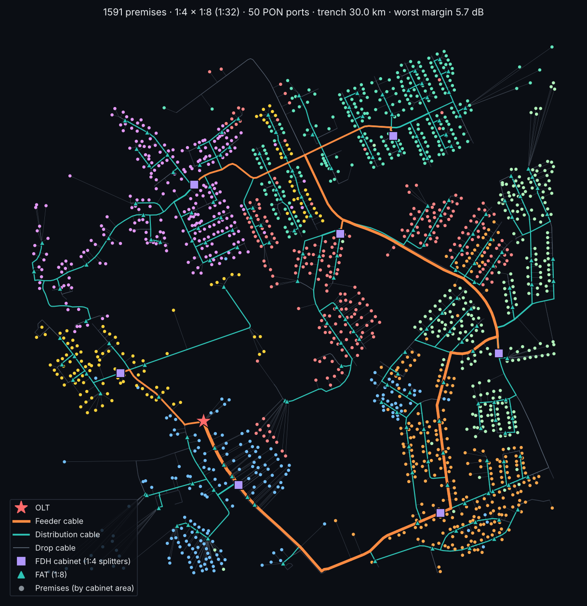
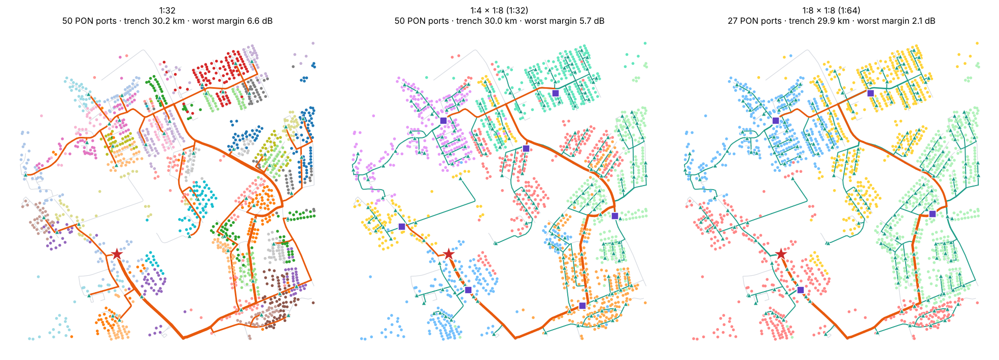
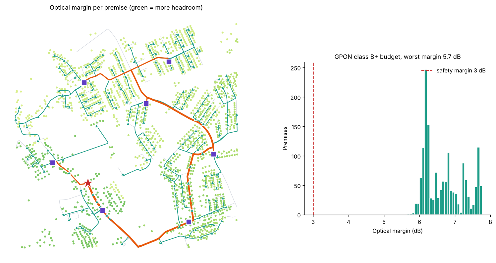
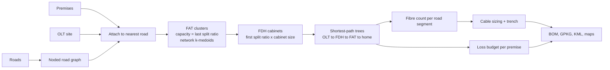

# fttxplan

**Open-source FTTx / GPON network planning in Python.** Give it roads, an OLT site and the buildings you want to connect. It routes fibre along the real street network, places splitters and cabinets, sizes every cable, checks the optical power budget for each home and gives you a bill of materials. A first-pass design for a neighbourhood of 1,500 homes takes about two seconds.

[](https://github.com/Gull01/fttxplan/actions/workflows/ci.yml)




<sub>A full 1:4 x 1:8 design for 1,591 buildings on real OpenStreetMap roads (the sample area that ships with the package). Orange is feeder cable, teal is distribution cable, purple squares are FDH cabinets, triangles are FAT boxes, and homes are coloured by the cabinet that serves them.</sub>

## Why I built this

I design FTTx networks for a living. Most of that work happens in expensive desktop GIS tools, and the first draft of a design (where do the cabinets go, how many PON ports, how much cable, does the far end of the area still close the optical budget) is still done largely by hand. That first draft is exactly the part that can be automated, and there was no open, scriptable tool for it. `fttxplan` is that tool: reproducible, testable and free to use for planning, feasibility studies, cost estimates and teaching.

## What it does

- **Builds a routable road graph** from OpenStreetMap or your own centreline file, noding every intersection and dropping disconnected fragments.
- **Connects every premise** to its nearest road position. The drop is split into the part that runs along the road and the final lead-in.
- **Places splitters by road distance, not straight lines.** Capacity-constrained clustering followed by network k-medoids keeps a 1:8 FAT from serving homes on the other side of a river or a railway.
- **Groups first-level splitters into FDH cabinets** (8 per cabinet by default), so one cabinet serves up to 256 homes, the way real distributed-split networks are built.
- **Routes feeder, distribution and drop cable along shortest-path trees**, so routes share trenches. On the sample area, sharing saves 91% of trench compared with laying every link separately.
- **Sizes every cable segment** (12/24/48/96/144/288 fibre) from the fibres it actually carries plus a configurable spare percentage.
- **Checks the optical loss budget for every single premise** (fibre attenuation, splitters, connectors, splices) against GPON class B+, C+ or C++. Homes below the safety margin are flagged.
- **Produces a bill of materials**: cable by type and size, splitters, cabinets, FATs, splice closures, trench, handholes, OLT ports and cards, ONTs and connectors. Pass your own unit prices to get a cost estimate.
- **Exports** to GeoPackage (QGIS / ArcGIS Pro), KML (Google Earth), GeoJSON and CSV. It also draws a static map and an interactive web map.
- **Works from the command line** with no Python code at all, including a one-line `osm` command for any place on Earth.

## Install

```bash
pip install git+https://github.com/Gull01/fttxplan.git
# add the OpenStreetMap downloader
pip install "fttxplan[osm] @ git+https://github.com/Gull01/fttxplan.git"
```

Python 3.10 or newer. The core depends on GeoPandas, Shapely 2, NetworkX, SciPy and scikit-learn.

## Quick start

```python
import fttxplan

roads, buildings, olt = fttxplan.load_demo()  # real OSM data that ships with the package
design = fttxplan.plan(roads, olt, buildings, split_levels="1:4x1:8")

print(design.report())
design.bom()  # bill of materials as a DataFrame
design.loss_budget()  # optical budget per premise, worst first
design.plot()  # static map (matplotlib)
design.explore()  # interactive map (folium)
design.to_gpkg("design.gpkg")  # every layer in one GeoPackage
```

```text
FTTx design  (1:4 x 1:8 (1:32) split, 1591 premises)
  PON ports         50  (4 OLT card(s))
  Splitters         50 x 1:4 FDH, 199 x 1:8 FAT  in 7 cabinet(s)
  Feeder cable      5.00 km
  Distribution      24.40 km
  Drop cable        166.55 km
  Trench            30.01 km  (sharing saves 91% vs separate routes)
  Longest path      5857 m  (reach limit 12250 m)
  Worst margin      5.65 dB  (0 premises below the 3 dB margin)
  Long drops        59  (> 150 m from a road)
  Computed in       1.7 s
```

Your own data works the same way: any road lines and any building points or footprints that GeoPandas can read, in any coordinate system.

```python
design = fttxplan.plan("roads.shp", (73.0551, 33.7215), "buildings.gpkg", split_levels="1:8x1:8", spare_ratio=0.3, budget_db=32)
```

## Command line

```bash
# the bundled sample area: writes design.gpkg, design.kml, bom.csv, loss_budget.csv, report.txt, map.png, map.html
fttxplan demo -o demo_output

# your own files
fttxplan design roads.gpkg buildings.gpkg --olt 73.0551,33.7215 --split 1:4x1:8 -o my_design

# straight from OpenStreetMap, anywhere in the world (needs the [osm] extra)
fttxplan osm --place "F-7, Islamabad, Pakistan" --olt 73.0551,33.7215 -o f7_design
fttxplan osm --point 33.7215,73.0551 --dist 800 --split 1:32
```

Useful options: `--split` (architecture), `--spare` (spare fibre fraction), `--budget` (dB, or `B+`, `C+`, `C++`), `--cabinet-size` (first-level splitters per FDH), `--no-map`.

## Comparing architectures

Changing one argument re-plans the whole area, so comparing options takes seconds.



| Architecture | PON ports | Splitters | Feeder km | Distribution km | Drop km | Trench km | Worst margin dB |
|---|---:|---:|---:|---:|---:|---:|---:|
| 1:32 | 50 | 50 | 14.7 | 0.0 | 324.6 | 30.2 | 6.6 |
| 1:4 x 1:8 (1:32) | 50 | 249 | 5.0 | 24.4 | 166.5 | 30.0 | 5.7 |
| 1:8 x 1:8 (1:64) | 27 | 226 | 4.3 | 23.8 | 166.5 | 29.9 | 2.1 |

A single 1:32 stage needs a fifth of the splitters but about twice the drop cable. 1:64 saves almost half of the OLT ports, but 543 homes fall below the 3 dB safety margin on class B+ optics, so it would need C+ optics or a smaller area per PON.

## Optical budget

Every premise gets its own loss calculation:

```
loss = length_km x 0.35 dB/km  +  splitter losses  +  4 connectors x 0.5 dB  +  splices x 0.1 dB
margin = optics budget (28 dB for class B+) - loss
```

Splitter losses follow typical PLC datasheet maxima (1:2 3.7, 1:4 7.3, 1:8 10.5, 1:16 13.7, 1:32 17.1, 1:64 20.5 dB). There is one splice at the OLT side, one per splitter and one every 2 km of cable. All of these values can be changed in `DesignConfig`.



## How it works



1. **Graph.** Road lines are projected to the local UTM zone, snapped, noded at every intersection and turned into an undirected NetworkX graph. Shortest paths run on a SciPy sparse matrix, so thousands of searches take seconds.
2. **Attachment.** Each premise and the OLT are projected onto their nearest road edge, which is split there. The straight lead-in distance is kept as the last part of the drop.
3. **Splitter placement.** Premises are grouped into clusters no larger than the last split ratio. The grouping starts from k-means, then a capacity-respecting assignment where points with the most to lose choose first. It is then refined as a capacitated k-medoids problem on road distance, and every splitter sits on the road node that minimises total cable to its members. Upper levels repeat the process on the splitters below them, with first-level splitters packed into cabinets.
4. **Routing.** Every link (OLT to FDH, FDH to FAT, FAT to home) follows the shortest road path. Paths from one source form a tree, so cables naturally share trenches. Fibres are counted per road segment and per tier.
5. **Engineering checks.** Cable size per segment comes from fibres used plus spare. The loss budget is computed per premise, and long lead-ins are flagged.

## Outputs

| Layer | Geometry | Key columns |
|---|---|---|
| `olt` | point | `pon_ports`, `cards` |
| `splitters` | point | `splitter_id`, `cabinet_id`, `role` (FDH/FAT/SPL), `ratio`, `parent_id`, `ports_used`, `utilisation`, `upstream_m` |
| `premises` | point | `premise_id`, `fat_id`, `fdh_id`, `attach_m`, `drop_total_m`, `path_m`, `loss_db`, `margin_db`, `budget_ok`, `long_drop` |
| `cables` | line | `tier` (feeder/distribution/drop), `fibres_used`, `fibres_required`, `cable_size`, `n_cables`, `length_m` |
| `drops` | line | the full drop route from FAT to building, per premise |
| `trench` | line | every road segment that carries cable, with fibre counts per tier |

Bill of materials for the sample area (cable lengths include 10% slack):

| Category | Item | Quantity | Unit |
|---|---|---:|---|
| Cable | Feeder cable 12F / 24F / 48F / 96F | 1,688 / 353 / 3,122 / 338 | m |
| Cable | Distribution cable 12F / 24F / 48F | 24,757 / 1,836 / 250 | m |
| Cable | Drop cable 1F | 183,200 | m |
| Passive | PLC splitter 1:4 / 1:8 | 50 / 199 | pcs |
| Enclosure | FDH cabinet / FAT / inline splice closure | 7 / 196 / 2 | pcs |
| Civil | Trench or duct route | 30,006 | m |
| Civil | Handhole / manhole (every 200 m) | 151 | pcs |
| Active | OLT PON ports / line cards / ONTs | 50 / 4 / 1,591 | pcs |

## Configuration

```python
from fttxplan import DesignConfig

cfg = DesignConfig(
    split_levels="1:4x1:8",  # or "1:32", "1:8x1:8", (2, 16) ...
    cabinet_size=8,  # first-level splitters per FDH cabinet
    spare_ratio=0.2,  # 20 % spare fibres on every cable
    slack_ratio=0.1,  # 10 % extra cable in the BOM
    budget_db=28.0,  # class B+; use fttxplan.PON_CLASSES["C+"] for 32 dB
    safety_margin_db=3.0,
    fiber_loss_db_per_km=0.35,
    max_drop_m=150,  # flag buildings further than this from a road
    seed=0,  # designs are fully reproducible
)
design = fttxplan.plan(roads, olt, buildings, cfg)
```

## Scope and limitations

This is a planning tool. It produces a sound first design and reliable quantities, not construction drawings. Things to keep in mind:

- Cables are sized per road segment. Real cable runs and splice points are decided during detailed design.
- Routing follows the road graph. Aerial routes on existing poles, private land and river crossings are not modelled yet.
- A building counts as one premise. Multi-dwelling buildings with many units are on the roadmap.
- Splitter placement is a strong heuristic, not a proven optimum.

## Roadmap

- [ ] Multi-dwelling units (a `units` column per building)
- [ ] Aerial routing on pole layers with span limits
- [ ] Cost-driven optimisation (trench vs cable vs splitter trade-offs)
- [ ] Explicit cable runs with splice points and fibre allocation
- [ ] QGIS plugin
- [ ] PyPI release

## Development

```bash
git clone https://github.com/Gull01/fttxplan.git && cd fttxplan
pip install -e ".[dev,osm]"
pytest                      # 59 tests including doctests, about 93% coverage
ruff check . && ruff format --check .
python docs/make_figures.py # regenerate the README images
```

Contributions are welcome. See [CONTRIBUTING.md](CONTRIBUTING.md).

## Data and citation

The sample area contains OpenStreetMap data © OpenStreetMap contributors, available under the [Open Database License](https://www.openstreetmap.org/copyright). It is the small extract used by the pyrosm test suite.

If you use `fttxplan` in research, please cite it using [CITATION.cff](CITATION.cff).

## Author

**Gul Nawaz**, GIS Specialist (FTTx network design) and MS Remote Sensing & GIS, NUST.
[gulnawaz.dev](https://gulnawaz.dev) · MIT License
